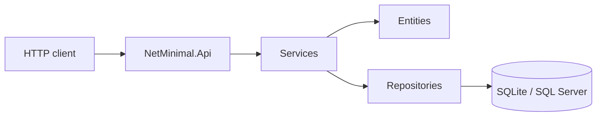

# Architecture

NetMinimal is a **single-project** ASP.NET Core 9 minimal API. Folders keep domain, services, data, and HTTP apart; they all compile into `NetMinimal.Api`.

```
tests/NetMinimal.Tests  →  src/NetMinimal.Api
```



## Request flow

1. `Program.cs` builds the host, registers DI, initializes `AppServices`, migrates and seeds the database.
2. A request hits a route group under `/api/v1`.
3. `ValidationFilter<T>` runs FluentValidation when the body type has a registered validator.
4. The endpoint handler receives a service from DI (`IProductService`, `ICategoryService`).
5. The service loads/saves through repository ports and `IUnitOfWork`.
6. Entities enforce invariants (`Guard`, price/stock rules, slug generation).
7. Failures throw `AppException` subclasses. `GlobalExceptionHandler` maps them to ProblemDetails.
8. Success returns `TypedResults` (`Ok`, `Created`, `NoContent`).

## Folder map (`src/NetMinimal.Api`)

| Folder | What lives here |
| --- | --- |
| *(root)* | `Program.cs`, `appsettings`, launch settings |
| `Endpoints/` | HTTP maps for products and categories |
| `Filters/` | `ValidationFilter<T>` |
| `Middleware/` | `GlobalExceptionHandler` |
| `Domain/Entities/` | `Product`, `Category`, `Entity` |
| `Domain/Exceptions/` | `AppException` and subclasses |
| `Domain/StaticServices/` | `Guard`, `Clock`, `SlugGenerator`, `Text` |
| `Application/Abstractions/` | `IProductRepository`, `ICategoryRepository`, `IClock`, `IUnitOfWork` |
| `Application/Services/` | Product and category use cases |
| `Application/Contracts/` | Request/response records |
| `Application/Validation/` | FluentValidation validators |
| `Application/Mapping/` | Entity → DTO |
| `Infrastructure/Data/` | `CatalogDbContext`, repositories, migrations, seeder |
| `Infrastructure/Options/` | `DatabaseOptions`, `CorsSettings` |
| `Infrastructure/Services/` | `SystemClock` |
| `Infrastructure/StaticServices/` | `AppServices` locator |

The test project is the only other project. It references the API and does not ship with it.

## Host bootstrap (`Program.cs`)

```text
Register services, options, EF Core, CORS, OpenAPI
Build()
AppServices.Initialize(app.Services)
Migrate + optional seed
UseExceptionHandler / HTTPS / CORS
MapOpenApi + Scalar
MapHealthChecks("/health")
Map /api/v1 category and product endpoints
```

`public partial class Program;` exists so `WebApplicationFactory<Program>` can host the app in tests.

## Cross-cutting behavior

| Concern | Implementation |
| --- | --- |
| Validation | FluentValidation + `ValidationFilter<T>` |
| Errors | `IExceptionHandler` + `IProblemDetailsService` |
| Health | EF Core `AddDbContextCheck<CatalogDbContext>("database")` |
| Time | `IClock` (DI) and `Clock` (static, test-freezable) |
| CORS | `Cors:AllowedOrigins` |
| OpenAPI | `AddOpenApi()` / `MapOpenApi()` / Scalar UI |
